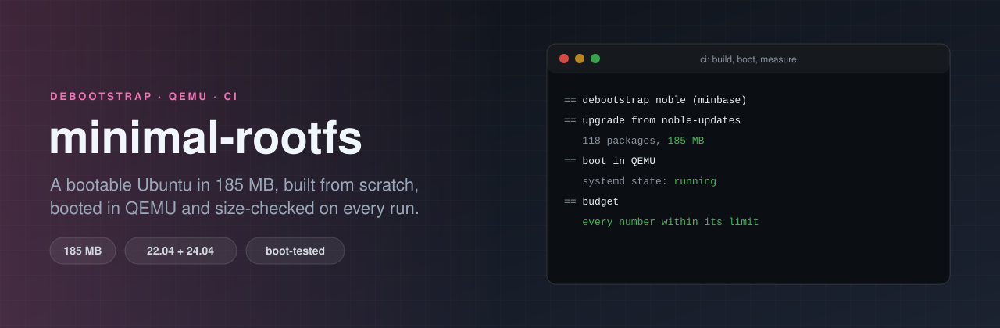

<p align="center">
  
</p>

# minimal-rootfs

[](https://github.com/ErenOzgu/minimal-rootfs/actions/workflows/ci.yml)
[](LICENSE)

A bootable Ubuntu 22.04 or 24.04 root file system, built from scratch with `debootstrap`, written into an ext4 image **without mounting anything**, and booted in QEMU on every CI run. The same run measures the result and fails if it grows past a budget.

The shell scripts are short. The point is the loop around them: *build it, boot it, measure it, fail if it got fat.* Without the boot step a minimal image is just a directory that might work.

```sh
sudo apt-get install debootstrap qemu-system-x86 e2fsprogs

sudo ./build.sh noble out/noble          # about two minutes
sudo ./boot-test.sh out/noble            # boots it in QEMU, passes or fails
sudo ./report.sh out/noble budget.txt    # sizes, boot facts, budget check
```

| | Ubuntu 24.04 (`noble`) | Ubuntu 22.04 (`jammy`) |
|---|---:|---:|
| Root file system | 185 MB | 253 MB |
| of which kernel modules | 28 MB | 104 MB |
| of which everything else | 115 MB | 111 MB |
| Root file system as `tar.gz` | 101 MB | 99 MB |
| ext4 image | 284 MB | 357 MB |
| Installed packages | 118 | 124 |
| Memory in use after boot | about 60 MB | about 40 MB |

Numbers are from the build in October 2026 (kernels 6.8.0-147 and 5.15.0-198). The run page of every CI job shows the current ones, with the biggest packages.

## What `build.sh` does

1. `debootstrap --variant=minbase` plus exactly what a boot needs: `systemd-sysv` (`/sbin/init`), `linux-image-virtual` (a kernel with the virtio drivers, and its modules) and `initramfs-tools` (it loads `ext4` and `virtio_blk` before `/` exists).
2. **Brings it up to date** from the `-updates` and `-security` pockets, then removes the older kernel the upgrade leaves behind. Without that step you ship release-day packages.
3. **No Recommends** (`APT::Install-Recommends "false"` is also written into the image). An earlier version of the upgrade step did not do that, and apt quietly pulled in grub, iso-codes and a Python standard library: 248 MB instead of 185 MB, for nothing a boot uses.
4. Trims documentation, man pages and locales, but keeps every package's `copyright` file, so the licences still travel with the binaries. A `dpkg` config in the image stops later installs from bringing the documentation back.
5. Writes the root file system into an ext4 image with `mke2fs -d`. No loop device and no `mount` for this step, so it cannot leave a stale mount behind. (The `chroot` step that upgrades the packages does mount `/proc`, `/sys` and `/dev`, and unmounts them again from an `EXIT` trap.)

## What `boot-test.sh` checks

It starts the image with `qemu-system-x86_64`, handing QEMU the kernel and initramfs directly (`-kernel`, `-initrd`), with no network and the serial console written to a file. The image has one extra systemd unit, `boot-ok.service`. It is ordered after `multi-user.target`, and does three things:

- waits for `systemctl is-system-running --wait`, and prints the state (the test wants `running`, not `degraded`);
- prints the kernel version, the failed units, memory use, the process count and the `systemd-analyze` timing;
- prints a marker line and powers the machine off.

The script passes only if the marker is on the console and the state was `running`. A hang is caught by a timeout. KVM is used if `/dev/kvm` is usable, otherwise it falls back to software emulation (several times slower; the CI summary says which one ran).

## What `report.sh` and the budget do

`report.sh` writes a markdown summary (CI puts it on the run page), a `report.json`, and compares a few numbers with `budget.txt`:

```
# SUITE METRIC MAX
noble rootfs_mb 210
noble packages 135
jammy modules_mb 120
```

The limits sit about 12% above what the build produced when they were set. They are there to catch a change that makes an image noticeably bigger (a dependency that crept in, a new kernel flavour), not every point release. CI also runs weekly, because the images come from the live Ubuntu archive and the archive changes without any commit here.

## What the numbers say

- **On 22.04 the kernel modules are the image.** 104 MB of 253 MB. The kernel, its modules and the initramfs together are 53% of the root file system.
- **On 24.04 they are only 33%**, because 24.04 ships its modules compressed (`.ko.zst`; 22.04 ships plain `.ko`). That one packaging change is why 24.04 is 68 MB smaller although its userland is 3 MB larger.
- **The initramfs (19 to 21 MB) is bigger than the kernel itself** (11 to 14 MB). `initramfs-tools` builds a generic one that includes most drivers, because it cannot know the hardware. Shrinking it needs `MODULES=dep` or a different generator, and that would also make the image depend on the machine that built it. It was left alone.
- **Everything else is small.** Nothing in the userland is outside the usual suspects: `libc6`, `systemd`, `udev`, `perl-base`, `coreutils`.

## What this is not

- **Not a distribution image.** There is no bootloader and no partition table: the ext4 file system is the whole disk, and the test hands the kernel to QEMU. To use it on a real VM or a cloud image you add a bootloader, or boot it the way the test does.
- **Not loginable.** The root account is locked and there are no users, no SSH, no network configuration. It is a measurement and test image. `boot-ok.service` powers the machine off after boot, so remove the symlink `etc/systemd/system/multi-user.target.wants/boot-ok.service` from the root file system if you use the image for something else.
- **Not reproducible bit for bit.** The packages come from the archive as it is today; the budget has headroom for that, a checksum would not.
- **Not tested on anything else.** Only `amd64`, `jammy` and `noble`, built on an `ubuntu-24.04` runner.
- **Not smaller than it can be.** `systemd` and `udev` could go for a container-style image. This one boots, so they stay.

## Layout

```
build.sh        debootstrap -> rootfs/, rootfs.ext4, vmlinuz, initrd.img
boot-test.sh    boot it in QEMU, wait for the marker
report.sh       sizes and boot facts as markdown and JSON, budget check
budget.txt      per-suite limits
overlay/        files copied into the image: boot-ok.service, boot-ok, fstab
```

## License

MIT, see [LICENSE](LICENSE).
